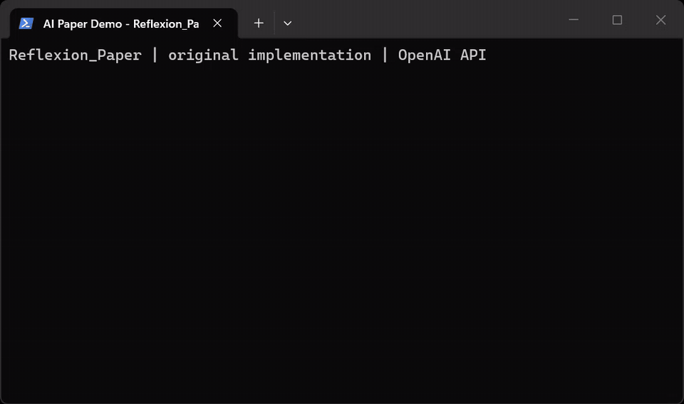

# Reflexion (minimal)

<!-- native-api-terminal-demo -->
## Terminal demo



Screen recording of the existing implementation using OpenAI `gpt-4o-mini`, at normal playback speed. The animation plays inline. Commands, source revision, and terminal output are saved in `media/`.


Paper: [Reflexion: Language Agents with Verbal Reinforcement Learning](https://arxiv.org/abs/2303.11366)

## Algorithmic flow (paper)

1) The actor attempts the task and produces an answer.
2) An evaluator judges the attempt and returns feedback.
3) A reflector summarizes lessons from the attempt and feedback.
4) The actor retries with a memory of recent reflections.
5) Repeat until the task passes or the trial limit is reached.
6) The actor receives the most recent `omega` reflections at each iteration.

## Exceptions in this repo

- CoT-based Reflexion only; the ReAct/tool-calling variant is not implemented yet.
- The evaluator is LLM-based judge instead of environment reward or task-specific tests as in the paper.
- Actor outputs fall back to raw text on parse failure; invalid evaluator responses fail closed.
- Reflection memory is single-task only; the paper also explores cross-task memory which I personally thought was not really needed at a simpler level.

## Run the code

1) Install deps

```bash
pip install openai
```

2) Set your API key

Set the environment variable before running (PowerShell):

```powershell
$env:OPENAI_API_KEY="sk-..."
```

3) Run the demo

```bash
python core.py
```

## Files

- `core.py`: core roles and Reflexion loop

## Offline checks

```bash
python -m pip install pytest openai
python -m pytest test_judge.py -q
```
