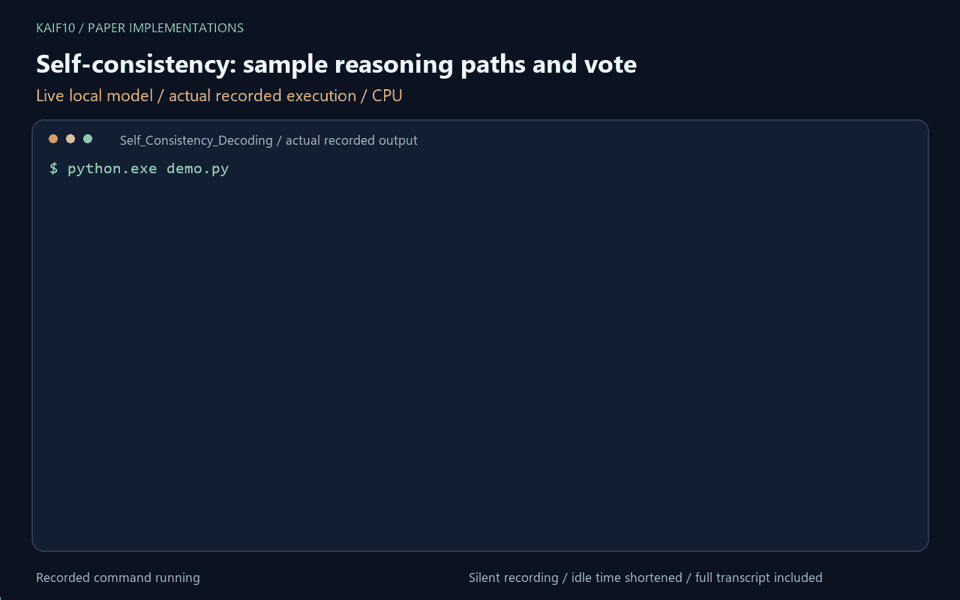

# Self-Consistency Decoding

<!-- project-working-demo -->
## Working demo



Live local Qwen2.5-0.5B-Instruct run on CPU. The animation plays here automatically; idle time is shortened.

To rerun, first install the local demo dependencies with `python -m pip install -r ../scripts/local-demo-requirements.txt`. Then, from this folder, run `python demo.py`. The full output and recording details are saved in `media/`.


Paper: [Self-Consistency Improves Chain of Thought Reasoning in Language Models](https://arxiv.org/abs/2203.11171)

## Algorithmic flow (paper)

1) Build a few-shot chain-of-thought prompt for the task.
2) Sample multiple reasoning paths with stochastic decoding.
3) Extract the final answer from each sampled path.
4) Take the majority vote over answers to select the final prediction.

## Exceptions in this repo

- The original paper uses Google's PALM, we have used QWEN

## Run the code

1) Run cells top-to-bottom. Adjust:

- `GenCfg`: number of samples `m`, temperature, and sampling params
- `TASK`: `arithmetic` or `commonsense`
- `question`: the prompt to solve


## Reproducible use

Run the notebook from this directory so `answer_parsing.py` is importable
(or upload that file alongside the notebook in Colab). Set `GenCfg.seed` to
record the sampling seed. Numeric votes normalize equivalent forms such as
`1000`, `1,000.0`, and `1e3`; unparsed outputs abstain and the notebook reports
how many samples were parsed. The saved outputs are demonstrations on individual
questions, not dataset accuracy measurements.

```bash
python -m pip install pytest
python -m pytest test_answer_parsing.py -q
```
