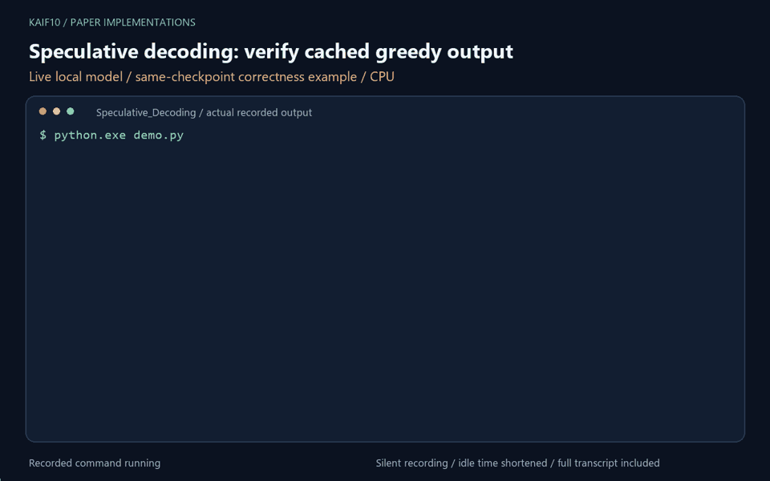

# Speculative Decoding — from scratch, end to end

<!-- project-working-demo -->
## Working demo



Animated terminal transcript of a real local Qwen2.5-0.5B-Instruct run on CPU; same-checkpoint correctness demonstration. The animation plays here automatically; idle time is shortened.

To rerun, first install the local demo dependencies with `python -m pip install -r ../scripts/local-demo-requirements.txt`. Then, from this folder, run `python demo.py`. The full output and recording details are saved in `media/`.


A readable implementation of the core algorithm from
**["Fast Inference from Transformers via Speculative Decoding"](https://arxiv.org/abs/2211.17192)**
(Leviathan, Kalman & Matias, ICML 2023; concurrently
[Chen et al. 2023](https://arxiv.org/abs/2302.01318)).

No training, no GPU required, no library `generate()` shortcuts — the entire
draft → verify → accept/reject loop is written out in
[`speculative_decoding.py`](speculative_decoding.py).

## The idea

Autoregressive decoding is slow because each token needs one full forward pass
of a large model, which can be memory-bandwidth-bound at small batch sizes.
Speculative decoding fills that idle compute:

1. **Draft.** A small, cheap model proposes `K` tokens, one at a time, recording
   its probabilities `q(x)`.
2. **Verify.** The large *target* model scores all `K` proposals in **one**
   forward pass, giving the true probabilities `p(x)` at every position.
3. **Accept / reject.** Walk the proposals left to right. Accept token `x` with
   probability `min(1, p(x)/q(x))`. On the first rejection, resample that token
   from the residual distribution `(p − q)₊` (renormalised) and stop the round.
   If all `K` are accepted, take a free **bonus** token from the target's next
   distribution.

Each round costs **one** target forward pass but emits between 1 and `K+1`
tokens. Wall-clock speedup also depends on draft cost and verification overhead.

### Why it's lossless

The accept/reject + residual-resampling rule is constructed so the emitted
tokens are distributed **exactly** as if sampled from the target model alone
(paper, Theorem 1). Speculative decoding changes *speed*, not *output quality*.
`verify_lossless.py` checks this empirically.

## Files

| File | What it does |
|------|--------------|
| `speculative_decoding.py` | The full algorithm: draft loop, parallel target scoring, acceptance test, residual resampling, bonus token. Two implementations: a readable **uncached** reference and a **KV-cached** version (the realistic serving path) that crops the cache on rejection. Plus matching autoregressive baselines. |
| `benchmark.py` | Runs baseline vs. speculative on the same prompt; reports latency, tok/s, speedup, and acceptance rate. KV-cached by default (`--no-cache` for the O(n²) reference). |
| `experiment.py` | Reproduction study on **Qwen2.5**: sweeps the draft length K, measures acceptance α and the cost ratio c, and checks the measured wall-clock speedup against the **paper's closed-form speedup formula**. |
| `verify_lossless.py` | Correctness: greedy output is identical to the target; sampling matches the target distribution (total-variation distance). |

## Setup

```bash
cd Speculative_Decoding
python3 -m venv .venv
source .venv/bin/activate
pip install -r requirements.txt
# For offline regression tests: pip install pytest
```

## Run

```bash
# Reproduction study on a modern open LLM (Qwen2.5, Apache-2.0, no API key/gating)
python experiment.py        # 0.5B draft + 3B target: K-sweep vs the paper's formula
python verify_lossless.py   # empirical correctness checks

# Single A/B benchmark
python benchmark.py --draft Qwen/Qwen2.5-0.5B --target Qwen/Qwen2.5-3B \
                    --max-new-tokens 128 --K 4 --temperature 0.7
python benchmark.py --no-cache ...          # the O(n²) uncached reference
```

First run downloads the models (~7 GB for the Qwen2.5 0.5B + 3B pair).

## Results — does it match the paper?

Measured on **Qwen2.5-0.5B (draft) + Qwen2.5-3B (target)**, Apple M-series MPS,
fp16, KV-cached, 96 new tokens, temperature 0.7:

```
  K   accept α  tgt fwd    tok/s  speedup  predicted
----------------------------------------------------
  1      76.4%       55    12.69    1.15x      1.47x
  3      72.3%       37    14.06    1.27x      1.63x
  5      77.2%       29    13.95    1.26x      1.72x
  8      75.5%       26    11.03    1.00x      1.43x
   (baseline autoregressive: 11.06 tok/s;  measured cost ratio c = 0.20)
```

These are earlier single-prompt measurements, retained as an example rather than
an aggregate benchmark. The current experiment records repeated, synchronized
timings and measures cached one-token decode cost. Run it to produce a fresh
`experiment_results.json` with all timings and settings.

The paper's estimate is `(1-alpha**(K+1))/((1-alpha)*(c*K+1))`.
Our cached implementation performs one additional draft forward to maintain its
cache, so the experiment uses `c*(K+1)+1` in the denominator. This remains an
idealized estimate: verification cost, prefill, sampling, and Python overhead
also affect latency. A 0.5B/3B pair has an approximately 6x parameter ratio;
parameter count alone does not predict its latency ratio.

## Tuning knobs

- `--K` — draft length. Higher `K` means more tokens per accepted round but more
  wasted draft work when a rejection comes early. The sweet spot depends on the
  draft/target speed ratio and their agreement.
- `--temperature` — `0` is greedy (outputs identical to the baseline);
  higher values sample more diversely.
- `--draft` / `--target` — any two causal-LM checkpoints that **share a
  tokenizer** (the acceptance test compares token-level probabilities).

## Scope and validation

The implementation supports batch size one and a fixed number of generated
tokens (it does not stop at EOS). Both checkpoints must share token-to-ID
mappings; the benchmark checks this before generation. Probability arithmetic
uses fp32, including when model weights use lower precision. Numerical
roundoff can still affect comparisons between different forward-pass shapes.

`verify_lossless.py` runs greedy checks on both cached and reference paths and
an empirical first-token distribution check with downloaded GPT-2 models.
For fast offline regression tests, run from the repository root:

```bash
python -m pytest Speculative_Decoding/tests -q
```

The offline tests use a small deterministic causal model to exercise cache
cropping, full and partial acceptance, rejection, and output boundaries. They
also compare sampled frequencies against a known distribution; no weights or
API calls are needed. KV caching avoids recomputing past keys and values, but
attention still reads the growing history.
